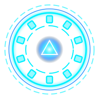

# J.A.R.V.I.S. — Autonomous AI Gesture-Controlled Holographic Interface
> **Just A Rather Very Intelligent System**  
> Inspired by Tony Stark's Iron Man Laboratory Holographic Interface.



---

## 🌟 Executive Overview

**Project JARVIS** is a futuristic, immersive, real-time 3D holographic human-computer interaction system. Operating directly inside modern browsers with local-first privacy, it combines:
- **Computer Vision & Hand Landmarking**: Powered by Google MediaPipe Vision tasks (`@mediapipe/tasks-vision`) with 21 3D hand landmarks tracked per hand at 60 FPS.
- **Neural Gesture Engine**: 12 predefined spatial gesture protocols with velocity and depth tracking, hysteresis filtering, and dynamic calibration.
- **3D Holographic Rendering**: Built with Three.js featuring 5 interactive holographic models (Arc Reactor MK-VII, Quantum Tesseract, Iron Man Armor Blueprint, Planetary Defense Grid, and Nanotech DNA Helix).
- **Cinematic Visual Effects**: Radial expanding energy shockwaves, floating particle fields, counter-rotating HUD gimbals, exploded assembly breakdown views, and color spectrum shifting.
- **Voice Assistant**: Natural language voice command execution, Web Speech API recognition, British AI speech synthesis, and real-time audio waveform frequency visualizers.
- **Iron Man HUD UI**: Cyberpunk electric blue/cyan HUD panels with system telemetry, containment status, circular SVG gauges, and quick action consoles.

---

## 🖐️ Gesture Control Protocols

All gestures are computed in real-time from webcam input:

| Gesture Name | Hand Pose / Movement | Action Triggered |
|---|---|---|
| **A. OPEN PALM** | All 5 fingers extended, palm forward | Activates interface / reveals main 3D object / wakes from standby |
| **B. CLOSED FIST** | All fingertips curled into palm | Pauses object movement / enters visual standby state |
| **C. PINCH** | Thumb tip + Index tip touching (< 0.055 distance) | Grabs holographic object / selects active element |
| **D. MOVE PINCHED** | Hold pinch while moving hand in $(X,Y,Z)$ | Translates selected 3D object in space |
| **E. ROTATE WRIST** | Tilt or roll wrist ($\Delta\text{roll} > 0.6\text{ rad}$) | Rotates holographic object on 3 axes |
| **F. TWO-HAND ZOOM** | Both hands detected, moving apart / together | Dynamically scales and zooms holographic object |
| **G. TWO OPEN PALMS** | Both hands open facing camera | Activates wide cinematic holographic view |
| **H. QUICK SWIPE** | Rapid horizontal hand flick ($\Delta X > 0.06$) | Cycles between holographic models / modules |
| **I. TWO-FINGER POINT** | Index & Middle extended, Ring & Pinky curled | Laser reticle targeting and precision control |
| **J. DOUBLE PINCH** | Two quick pinches within 450ms | Toggles exploded blueprint disassembly view |
| **K. PUSH FORWARD** | Rapid palm push toward camera ($\Delta Z < -0.035$) | Triggers cinematic radial energy shockwave explosion |
| **L. PULL BACK** | Hand pull away from camera ($\Delta Z > 0.035$) | Re-centers and returns object to origin anchor |

---

## 🎙️ Voice Assistant Commands

JARVIS continuously listens for speech input when the audio sensor is active:

| Voice Command Patterns | Category | JARVIS Action & Response |
|---|---|---|
| `"Hello JARVIS"` / `"Hey JARVIS"` | SYSTEM | "Good evening, sir. All holographic systems are online and awaiting your command." |
| `"Initialize holographic interface"` | NAVIGATION | Initializes central 3D hologram with activation sound. |
| `"Rotate the object"` / `"Rotate"` | MANIPULATION | Rotates the 3D model 360 degrees. |
| `"Expand it"` / `"Zoom in"` | MANIPULATION | Enlarges holographic dimensions. |
| `"Shrink it"` / `"Zoom out"` | MANIPULATION | Contracts holographic dimensions. |
| `"Reset object"` / `"Center object"` | MANIPULATION | Smoothly returns object to $(0,0,0)$ anchor. |
| `"Trigger shockwave"` / `"Cinematic pulse"` | CINEMATIC | Discharges radial energy shockwave and particle blast. |
| `"Exploded view"` / `"Disassemble"` | MANIPULATION | Engages exploded component disassembly view. |
| `"Assembled view"` / `"Reconstruct"` | MANIPULATION | Reassembles all components into solid core. |
| `"Switch to arc reactor"` | NAVIGATION | Projects the Arc Reactor MK-VII clean energy core. |
| `"Switch to tesseract"` | NAVIGATION | Projects the Quantum Tesseract 4D hypercube. |
| `"Switch to mark suit"` | NAVIGATION | Loads Iron Man Mark VII armor schematics. |
| `"Switch to planetary defense"` | NAVIGATION | Projects orbital defense satellite grid. |
| `"Switch to DNA"` | NAVIGATION | Synthesizes nanotech molecular double helix. |
| `"Status report"` / `"Diagnostics"` | SYSTEM | Reports power output, containment stability, and optical status. |
| `"Enter standby mode"` | SYSTEM | Enters power conservation standby screen. |
| `"What time is it"` | AI / PRODUCTIVITY | Speaks current system clock time. |

---

## 🔮 3D Holographic Models

1. **Arc Reactor MK-VII**:
   - Concentric counter-rotating gimbal rings.
   - 10 magnetic energy coils with emissive copper/cyan windings.
   - Central cylindrical plasma core with animated pulsating aura and inner triangular power token.
   - Radial flux energy points.
2. **Quantum Tesseract (4D Hypercube)**:
   - Outer wireframe cube and counter-rotating inner cube.
   - 8 hyper-dimensional vertex connection lines.
   - Central pulsating quantum singularity sphere with orbital containment rings.
3. **Iron Man Mark VII Armor Blueprint**:
   - Cranium dome, angular brow plate, cheek guards, and chin assembly.
   - Glowing eye slits with intensity pulse.
   - Vertical cybernetic targeting laser scan line.
4. **Stark Planetary Defense Grid**:
   - High-density latitude/longitude cyber globe.
   - 3 inclined orbital defense tracking rings.
   - 6 orbiting defense satellites with dynamic vector coordinates.
   - Real-time rotating radar scan beam.
5. **Nanotech Molecular DNA Helix**:
   - 60-point double helix strand with alternating nucleotide rung bonds.
   - Harmonic rotation with quantum vibration.

---

## 🏗️ Technical Architecture

```
jarvis.ai/
├── public/
│   ├── jarvis-arc.svg             # Futuristic Stark Arc Reactor SVG icon
│   ├── wasm/                      # Local MediaPipe Vision WebAssembly binaries
│   └── models/
│       └── hand_landmarker.task   # MediaPipe HandLandmarker neural model (7.8 MB)
├── src/
│   ├── types/
│   │   ├── gesture.ts             # 3D Landmark & 12 Gesture specifications
│   │   ├── hologram.ts            # 3D model definitions, transform & visual modes
│   │   └── assistant.ts           # Speech commands & dialogue definitions
│   ├── services/
│   │   ├── audioService.ts        # Web Audio API sound synthesizer (whooshes, shockwave, hum)
│   │   ├── speechService.ts       # Web Speech API recognition & speech synthesis
│   │   ├── handTracking.ts        # MediaPipe HandLandmarker camera processor
│   │   └── gestureEngine.ts       # 12-gesture spatial classifier with velocity/smoothing
│   ├── three/
│   │   ├── HologramScene.ts       # Three.js scene manager, camera, lighting & render loop
│   │   ├── objects/
│   │   │   ├── ArcReactor.ts      # Arc Reactor MK-VII 3D model
│   │   │   ├── QuantumTesseract.ts# Quantum 4D Tesseract model
│   │   │   ├── IronManArmor.ts    # Iron Man Mark VII helmet blueprint model
│   │   │   ├── HolographicGlobe.ts# Planetary defense cyber globe
│   │   │   └── MolecularHelix.ts  # Nanotech DNA double helix model
│   │   └── effects/
│   │       ├── EnergyShockwave.ts # Radial shockwave explosion animation
│   │       ├── ParticleField.ts   # 1,200 floating cyber particles
│   │       └── RingGimbals.ts     # HUD rotating calibration rings
│   ├── components/
│   │   ├── HologramCanvas.tsx     # Three.js canvas mount & gesture connector
│   │   ├── HUD/
│   │   │   ├── TopStatusBar.tsx   # System bar, clock, containment, FPS meter
│   │   │   ├── LeftVisionHUD.tsx  # Camera viewport, skeleton canvas, gesture telemetry
│   │   │   ├── RightDiagnosticsHUD.tsx # Model selector, specs, themes, desktop tools
│   │   │   ├── BottomControlHUD.tsx# Mode switcher, audio waveform, reset, shockwave
│   │   │   ├── VoiceConsoleHUD.tsx# Live transcript log & quick prompt chips
│   │   │   └── StandbyHUD.tsx     # Minimalist standby screen
│   │   └── Common/
│   │       ├── HolographicPanel.tsx# Cyber glass panel with corner brackets
│   │       └── CircularGauge.tsx  # SVG circular tech gauge
│   ├── App.tsx                    # Master coordinator connecting vision, 3D, and voice
│   ├── main.tsx                   # React entry point
│   └── index.css                  # Tailwind styles & neon glow rules
├── tests/
│   ├── gestureEngine.test.ts      # Automated tests for all 12 gesture protocols
│   ├── voiceAssistant.test.ts     # Tests for speech command parsing & actions
│   └── hologramScene.test.ts      # Tests for 3D translation bounds & scale clamping
├── vite.config.ts                 # Vite config with manual chunk optimization
├── package.json
└── README.md
```

---

## 🚀 Installation & Startup

### Prerequisites
- **Node.js**: v18.0.0 or higher (v20+ recommended)
- **Web Browser**: Chrome, Edge, Brave, or Firefox with WebGL and Webcam support.

### 1. Install Dependencies
```bash
npm install
```

### 2. Run Unit Tests
```bash
npm test
```

### 3. Start Development Server
```bash
npm run dev
```
Open your browser at `http://localhost:3000`.

### 4. Build for Production
```bash
npm run build
npm run preview
```

---

## 🔒 Privacy & Security Shield

- **100% Local Execution**: Camera video frames and MediaPipe hand tracking are processed entirely inside your local browser instance. No video footage or images are ever uploaded or transmitted to external servers.
- **Opt-In Sensor Permissions**: The camera and microphone are inactive by default upon startup. They activate only when you explicitly click **ENABLE CAM** or **VOICE OFF**.
- **Clear Indicators**: The top and left HUD panels display prominent status badges whenever optical or audio sensors are engaged.
- **Instant Revocation**: Toggling off the camera or microphone immediately stops and disconnects all hardware media tracks.

---

## 💡 Calibration & Troubleshooting

1. **Camera Permission Denied**:
   - Ensure browser permissions allow camera access for `localhost`.
   - In Chrome, click the camera icon in the URL bar and select *Always allow*.
2. **Gesture Sensitivity Tuning**:
   - Expand the **CALIBRATION // SENSITIVITY** accordion on the Left HUD.
   - Adjust **PINCH SENSITIVITY** if pinch requires more or less thumb-index distance.
   - Adjust **PUSH WAVE SENSITIVITY** to adjust how fast you need to push toward the camera to trigger the shockwave.
   - Adjust **SMOOTHING FACTOR** to balance between responsiveness and jitter reduction.
3. **Lighting Recommendations**:
   - For optimal hand landmark detection, ensure your hand is evenly illuminated against a contrasting background.
